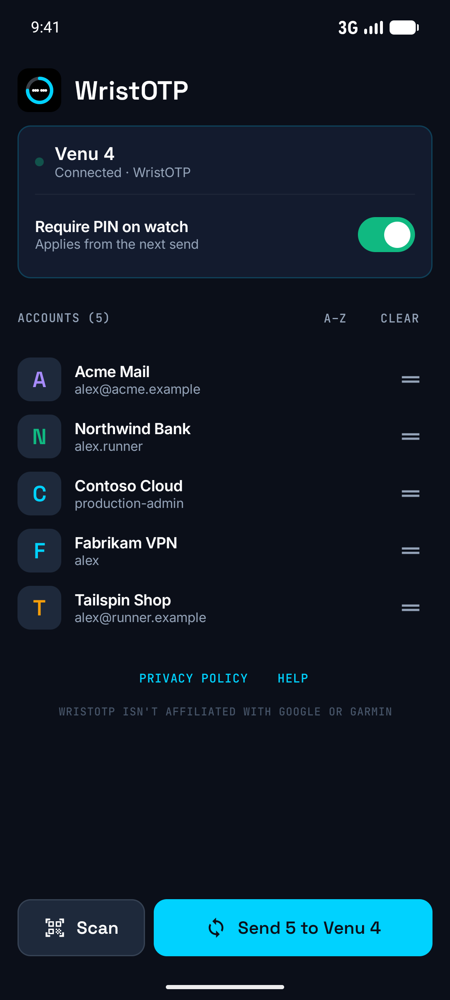
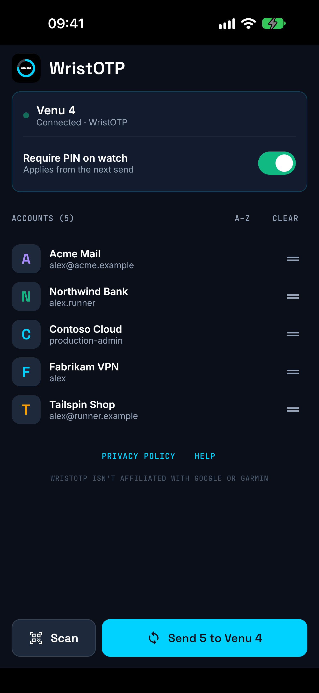

# wristotp

Your two-factor codes on your Garmin watch, alongside Google Authenticator.

Export your accounts from Google Authenticator, scan the QR code with the phone app and send them to your watch. Codes are generated offline, on your watch.

| Android | iPhone |
| --- | --- |
|  |  |

[Watch the full flow](docs/wristotp-flow.mp4)

- `watch/`: Connect IQ watch app (Monkey C).
- `companion/`: phone app (Kotlin Multiplatform + Compose Multiplatform) for Android and iOS. Imports Google Authenticator export QR codes and sends the accounts to the watch.
- `site/`: privacy policy and support pages.
- `scripts/release.sh`: builds the release files.

WristOTP isn't in any app store. You install it yourself.

## Install

You need the Garmin Connect app on your phone, with your watch paired.

### Watch

Supported watches: epix Pro (Gen 2) 47mm, fēnix 7, fēnix 8 47mm, Forerunner 265, Forerunner 965, Forerunner 970, Venu 3, Venu 4 41mm, Venu 4 45mm, vívoactive 6.

1. Download the `.prg` file for your watch from [Releases](https://github.com/lucanicoletti/wristotp/releases).
2. Connect your watch to your computer with its USB cable.
3. Copy the file into the `GARMIN/APPS` folder on the watch. (On Windows, use File Explorer. On a Mac, use [OpenMTP](https://openmtp.ganeshrvel.com).)
4. Unplug the watch. WristOTP is in the apps list.

### Android

1. Download `wristotp-<version>.apk` from [Releases](https://github.com/lucanicoletti/wristotp/releases).
2. Open it on your phone and allow installing from that source when asked.

### iPhone

There's no download for iPhone. Apple only lets you install apps from the App Store, TestFlight or Xcode, so you build it yourself.

1. Install Xcode and clone this repo.
2. Create `companion/iosApp/Configuration/Config.local.xcconfig` (it's ignored by git):
   ```
   TEAM_ID=<your Apple team ID>
   PRODUCT_BUNDLE_IDENTIFIER=<a bundle id of your own, e.g. com.yourname.wristotp>
   ```
3. Open `companion/iosApp/iosApp.xcodeproj`, plug in your iPhone, pick it as the run destination and press Run.

With a free Apple ID the app stops opening after 7 days. Run it from Xcode again to renew it. A paid Apple Developer account makes it last a year.

### Check your download

Each release has a `SHA256SUMS` file. In the folder with your downloads:

```
shasum -a 256 -c SHA256SUMS --ignore-missing
```

## Build from source

You need:

- JDK 17 and the Android SDK, for the Android app.
- Xcode, for the iOS app.
- The [Connect IQ SDK](https://developer.garmin.com/connect-iq/sdk/) and a developer key, for the watch app. (Create the key in the SDK Manager or with `openssl`, see Garmin's [getting started](https://developer.garmin.com/connect-iq/connect-iq-basics/getting-started/) guide.)

Phone app:

```
cd companion
./gradlew :composeApp:assembleDebug
./gradlew :composeApp:allTests
```

Watch app (one watch at a time):

```
cd watch
monkeyc -f monkey.jungle -d venu445mm -r -l 2 -y <path to your developer key> -o wristotp.prg
```

A watch app signed with your key isn't the same build as the one in Releases. If you switch between them, delete the old `.prg` from `GARMIN/APPS` first.

### Release

`scripts/release.sh` builds the signed APK, one `.prg` per supported watch and `SHA256SUMS` into `dist/`.

It needs `companion/keystore.properties` (ignored by git):

```
storeFile=<path to your keystore, relative to companion/>
storePassword=<password>
keyAlias=<alias>
keyPassword=<password>
```

Then:

```
DEVELOPER_KEY=<path to your developer key> scripts/release.sh
```

If the Connect IQ SDK isn't the one selected in the SDK Manager, set `CONNECTIQ_SDK` to its folder.

## Security

- The phone app doesn't save your accounts. They're kept in memory only while it's open.
- The watch saves them in the app's private storage. You can turn on a PIN. (Only a salted hash of the PIN is saved.) After 10 failed attempts the watch wipes all accounts.
- There are no servers, no analytics and no network calls. Accounts go from phone to watch only through Garmin Connect.

More in the [privacy policy](site/privacy.md).

## License

WristOTP is licensed under the [GNU General Public License v3.0](LICENSE).

The fonts (Inter, JetBrains Mono and Space Grotesk) are licensed under the SIL Open Font License 1.1. See [`licenses/`](licenses).

WristOTP isn't part of Google or Garmin. Google Authenticator is a trademark of Google LLC. Garmin and Connect IQ are trademarks of Garmin Ltd.
